**English** · [Português (Brasil)](README.pt-BR.md)

<a id="top"></a>

<p align="center">
  <picture>
    <source media="(prefers-reduced-motion: reduce)" srcset="docs/assets/readme/hero-still.svg" />
    
  </picture>
</p>

# Claude Desktop Mods

**See what Claude is doing, everywhere in the app.**

Three mods for the Code tab of the Claude desktop app: the sidebar files each chat by what Claude is doing, a band
above the prompt shows your session and weekly limits, and an **Environment** pane shows your project, the context
window and your connectors, with a small pixel Claude working in the folder it touches.

Install them with one line, and they run inside the app itself. **They read only what they draw, write nothing,
and send nothing over the network.**

<p align="center">
  <a href="#install"><strong>INSTALL WITH ONE LINE →</strong></a>
  &nbsp; · &nbsp;
  <a href="#sidebar">SEE THE MODS</a>
  &nbsp; · &nbsp;
  <a href="docs/README.md">READ THE DOCS</a>
</p>

<p align="center">
  <a href=".github/workflows/ci.yml"></a>
  &nbsp;
  <a href="LICENSE"><strong>MIT</strong></a>
  &nbsp; · &nbsp;
  <a href="#community">Star History</a>
  &nbsp; · &nbsp;
  <a href="docs/04-validation.md">Evidence and limits</a>
</p>

<p align="center">
  <strong>Claude desktop app</strong> / Code tab / <strong>macOS</strong>
  <br />
  3 mods / 34 tests / English and Portuguese
</p>

---

<a id="start-here"></a>

## 00 / Choose where to start

| Your situation | Path | What you get |
| --- | --- | --- |
| You want all three, now | [Install with one line](#install) | Sidebar sections, usage band and Environment pane in every chat |
| You want to know what each one does | [The mods](#sidebar) | What you see, and when it changes |
| You care about what they touch | [Privacy](#privacy) | What each mod reads and calls |
| You want to change one | [Configuration](#configuration) and [CONTRIBUTING.md](CONTRIBUTING.md) | Options, and how to work on a mod |

On this page: [Install](#install) · [Sidebar](#sidebar) · [Usage band](#usage-band) · [Environment](#environment) ·
[How it works](#how-it-works) · [Privacy](#privacy) · [Prompts](#prompts) · [Configuration](#configuration) ·
[Evidence](#evidence) · [Repository](#repository) · [Community](#community) · [License](#license)

<a id="install"></a>

## 01 / Install with one line

Paste this into a terminal on your Mac:

```bash
claude plugin marketplace add tfavareto/claude-desktop-mods && for m in chat-status usage-band environment-pane; do claude plugin install "$m@claude-desktop-mods"; done
```

Then quit the Claude app with **Cmd+Q** and open it again. Each chat loads the mods when it starts.

Or let an agent do it, permission rules and language included. Paste this into Claude Code:

```text
Read https://raw.githubusercontent.com/tfavareto/claude-desktop-mods/main/docs/prompts/01-install.md and execute the entire block in the "Prompt" section on this computer.
```

The agent will:

1. check that you are on macOS with the `claude` CLI;
2. add the marketplace and install the three mods;
3. ask before allowing the three sidebar calls that `chat-status` makes in auto mode;
4. ask your language, and switch the band and section names to Portuguese if you want.

### Prefer to do it by hand?

One mod at a time, from a Claude Code terminal session:

```text
/plugin install chat-status --marketplace tfavareto/claude-desktop-mods
```

In the desktop app itself: **+** next to the prompt box → **Plugins** → **Add marketplace**
`tfavareto/claude-desktop-mods` → **Add plugin**. Full steps, updates and uninstall:
[installation guide](docs/01-installation.md).

<a id="sidebar"></a>

## 02 / Know which chats need you

`chat-status` moves each chat to the sidebar section that says what Claude is doing, so the chats waiting on you
are never buried.

<p align="center">
  <picture>
    <source media="(prefers-reduced-motion: reduce)" srcset="docs/assets/readme/chat-status-still.svg" />
    
  </picture>
</p>

| Section | When the chat lands there |
| --- | --- |
| `🟢 Working` | A turn starts, or you answer the question that held it |
| `🟡 Needs your answer` | Claude asks you something, a permission prompt opens, or the app marks the chat with its yellow dot |
| `⏳ Waiting` | The turn ends with nothing pending and no background agent running |
| `⏸️ Paused` | You drag it there; your next message moves it back to Working |

The sections are created on first use, or reused when they already exist under the same name.

<a id="usage-band"></a>

## 03 / Watch your limits while you type

`usage-band` puts your plan's limits on one row above the prompt box: how much of the session and of the week
you used, when each resets, and where your current pace takes you.

<p align="center">
  <picture>
    <source media="(prefers-reduced-motion: reduce)" srcset="docs/assets/readme/usage-band-still.svg" />
    
  </picture>
</p>

| Part | What it tells you |
| --- | --- |
| **Session** bar | Percent of the 5-hour limit used, and the time to its reset |
| **Week** bar | Percent of the weekly limit used, and the time to its reset |
| Pace line | When a limit runs out at your current pace, if that comes before its reset |

The pace follows the clock: stop using Claude for a day and the estimate moves later on its own.

<a id="environment"></a>

## 04 / See where Claude is working

`environment-pane` opens an **Environment** pane beside the chat with everything about the chat's surroundings.

<p align="center">
  <picture>
    <source media="(prefers-reduced-motion: reduce)" srcset="docs/assets/readme/environment-pane-still.svg" />
    
  </picture>
</p>

| You want to | Where | What happens |
| --- | --- | --- |
| Turn Remote Control on or off | **Remote Control** | One press; the app asks you to approve |
| See what Claude is doing | **Folders** | The pixel Claude types, runs commands, reviews or thinks, live |
| Find the file it is on | **Folders** tree | The tree opens to it; a small Claude sits beside its folder |
| Browse the project | **Folders** tree | Click a folder to open it, a file to open it in the app |
| See what fills the context | **Context** | A split bar and columns; hover a column for exact tokens |
| Check your connectors | **Connectors** | Every connected connector and MCP server, with logos; used ones highlighted |

Reopen the pane any time with `/environment`.

<a id="how-it-works"></a>

## 05 / How it works

Each mod is a Claude Code plugin whose hooks module runs inside the engine, reacting to the chat's events and
drawing with the app's own elements.

| Mod | Listens to | Draws or does |
| --- | --- | --- |
| `chat-status` | Turn start and end, tool calls, permission prompts, the app's turn summary | Moves the chat with the app's sidebar tools |
| `usage-band` | Session start, each measurement, a one-minute clock | The band above the prompt (`AbovePrompt`) |
| `environment-pane` | Turns, tool calls (the file each one names), context measurements, a five-second clock | The **Environment** pane (`Pane`) |

1. The app starts a chat, and the engine loads the three mods from this marketplace.
2. Each mod hooks the events it needs and keeps its figures in the session's state.
3. A change in that state redraws the band or the pane; the sidebar moves through the app's tools.

<a id="privacy"></a>

## 06 / Stay in control of your data

The mods use only what the app already gives a chat, and nothing leaves your machine through them.

| What | How |
| --- | --- |
| Network | None: no mod makes a request of its own |
| Files | None written; the pane lists folder names and opens files through the app |
| Remote Control | Changes only on your press, with the app's own approval |
| State | Kept in the chat's session, gone when it closes |

Details per mod: [privacy and security](docs/03-privacy-and-security.md). Report a problem: [SECURITY.md](SECURITY.md).

<a id="prompts"></a>

## 07 / Hand the job to an agent

| Goal | Prompt | When to use |
| --- | --- | --- |
| Install everything | [01 · Install](docs/prompts/01-install.md) | First install |
| Remove everything | [02 · Uninstall](docs/prompts/02-uninstall.md) | When you no longer want the mods |

<a id="configuration"></a>

## 08 / Make it yours

| Mod | Option | Default |
| --- | --- | --- |
| `chat-status` | `workingSection`, `waitingSection`, `responseSection` | `🟢 Working`, `⏳ Waiting`, `🟡 Needs your answer` |
| `usage-band` | `language` | `en` (or `pt-BR`) |

Set them with `claude plugin configure <mod>@claude-desktop-mods`; see the [installation guide](docs/01-installation.md#name-the-sections-in-your-language-optional).

<a id="evidence"></a>

## 09 / Evidence and limits

| Check | Result |
| --- | --- |
| Behaviour tests (`claude plugin test`, the engine's own kit) | 34 passing: chat-status 18, usage-band 6, environment-pane 10 |
| `claude plugin validate`, marketplace and mods | Passes |
| Type-check, `strict` | No errors |
| In the app | Used daily on macOS, Claude Code 2.1.309 |

Known limits: the yellow-dot reading is macOS-only; auto mode may need the sidebar calls allowed; chats opened
before the install need a restart or `/reload-plugins`; the pane sits beside the app's own side panel rather than
replacing it. All of them: [evidence and limits](docs/04-validation.md).

<a id="repository"></a>

## 10 / Explore the repository

```text
claude-desktop-mods/
├── .claude-plugin/marketplace.json   the marketplace: lists the three mods
├── plugins/
│   ├── chat-status/                  sidebar sections by status
│   ├── usage-band/                   session and weekly limits above the prompt
│   └── environment-pane/             the Environment pane
├── docs/                             guides, prompts and README images
└── scripts/validate-docs.mjs         link, anchor and translation checks
```

| Guide | What it covers |
| --- | --- |
| [Installation](docs/01-installation.md) | Install, permissions, languages, update, uninstall |
| [The mods](docs/02-mods.md) | Every section, part and option |
| [Privacy and security](docs/03-privacy-and-security.md) | What each mod reads and calls |
| [Evidence and limits](docs/04-validation.md) | How it is checked, and what it does not do |
| [Troubleshooting](docs/05-troubleshooting.md) | Symptom, cause, fix |

Verify this checkout:

```bash
npm run test
npm run validate
npm run docs:check
```

<a id="community"></a>

## 11 / Follow the project

<a href="https://www.star-history.com/?repos=tfavareto%2Fclaude-desktop-mods&amp;type=date">
  <picture>
    <source media="(prefers-color-scheme: dark)" srcset="https://api.star-history.com/chart?repos=tfavareto/claude-desktop-mods&amp;type=date&amp;theme=dark" />
    <source media="(prefers-color-scheme: light)" srcset="https://api.star-history.com/chart?repos=tfavareto/claude-desktop-mods&amp;type=date" />
    
  </picture>
</a>

Ideas and bugs: [open an issue](https://github.com/tfavareto/claude-desktop-mods/issues/new/choose). Pull requests
are welcome: read [CONTRIBUTING.md](CONTRIBUTING.md) first.

<a id="license"></a>

## Credits and license

Built with Claude Code's plugin API. [MIT](LICENSE) © tfavareto.

<p align="center">
  <strong>LESS GUESSING. MORE BUILDING.</strong>
  <br />
  <a href="#top">Back to top ↑</a>
</p>
