[English](README.md) · **Português (Brasil)**

<a id="top"></a>

<p align="center">
  <picture>
    <source media="(prefers-reduced-motion: reduce)" srcset="docs/assets/readme/hero-still.svg" />
    
  </picture>
</p>

# Claude Desktop Mods

**Veja o que o Claude está fazendo, em todo o app.**

Três mods para a aba Code do app desktop do Claude: a barra lateral organiza cada chat pelo que o Claude está
fazendo, uma faixa acima do prompt mostra seus limites da sessão e da semana, e um painel **Environment** mostra seu
projeto, a janela de contexto e seus conectores, com um pequeno Claude em pixel art trabalhando na pasta que ele mexe.

Instale com uma linha, e eles rodam dentro do próprio app. **Eles só leem o que desenham, não gravam nada e não
enviam nada pela rede.**

<p align="center">
  <a href="#install"><strong>INSTALE COM UMA LINHA →</strong></a>
  &nbsp; · &nbsp;
  <a href="#sidebar">VEJA OS MODS</a>
  &nbsp; · &nbsp;
  <a href="docs/README.md">LEIA A DOCUMENTAÇÃO</a>
</p>

<p align="center">
  <a href=".github/workflows/ci.yml"></a>
  &nbsp;
  <a href="LICENSE"><strong>MIT</strong></a>
  &nbsp; · &nbsp;
  <a href="#community">Star History</a>
  &nbsp; · &nbsp;
  <a href="docs/04-validation.md">Evidências e limites</a>
</p>

<p align="center">
  <strong>App desktop do Claude</strong> / aba Code / <strong>macOS</strong>
  <br />
  3 mods / 34 testes / inglês e português
</p>

---

<a id="start-here"></a>

## 00 / Escolha por onde começar

| Sua situação | Caminho | O que você ganha |
| --- | --- | --- |
| Quer os três, agora | [Instale com uma linha](#install) | Seções na barra lateral, faixa de uso e painel Environment em todo chat |
| Quer saber o que cada um faz | [Os mods](#sidebar) | O que você vê, e quando muda |
| Se importa com o que eles acessam | [Privacidade](#privacy) | O que cada mod lê e chama |
| Quer mudar um deles | [Configuração](#configuration) e [CONTRIBUTING.md](CONTRIBUTING.md) | Opções, e como trabalhar num mod |

Nesta página: [Instalar](#install) · [Barra lateral](#sidebar) · [Faixa de uso](#usage-band) · [Environment](#environment) ·
[Como funciona](#how-it-works) · [Privacidade](#privacy) · [Prompts](#prompts) · [Configuração](#configuration) ·
[Evidências](#evidence) · [Repositório](#repository) · [Comunidade](#community) · [Licença](#license)

<a id="install"></a>

## 01 / Instale com uma linha

Cole isto num terminal do seu Mac:

```bash
claude plugin marketplace add tfavareto/claude-desktop-mods && for m in chat-status usage-band environment-pane; do claude plugin install "$m@claude-desktop-mods"; done
```

Depois feche o app do Claude com **Cmd+Q** e abra de novo. Cada chat carrega os mods quando inicia.

Ou deixe um agente fazer tudo, com as regras de permissão e o idioma. Cole isto no Claude Code:

```text
Read https://raw.githubusercontent.com/tfavareto/claude-desktop-mods/main/docs/prompts/01-install.md and execute the entire block in the "Prompt" section on this computer.
```

O agente vai:

1. conferir se você está no macOS com o CLI `claude`;
2. adicionar o marketplace e instalar os três mods;
3. perguntar antes de liberar as três chamadas da barra lateral que o `chat-status` faz no modo automático;
4. perguntar seu idioma e, se quiser, deixar a faixa e os nomes das seções em português.

### Prefere fazer à mão?

Um mod por vez, numa sessão do Claude Code no terminal:

```text
/plugin install chat-status --marketplace tfavareto/claude-desktop-mods
```

No próprio app desktop: **+** ao lado da caixa de prompt → **Plugins** → **Add marketplace**
`tfavareto/claude-desktop-mods` → **Add plugin**. Passo a passo, atualização e desinstalação:
[guia de instalação](docs/01-installation.md).

<a id="sidebar"></a>

## 02 / Saiba quais chats precisam de você

O `chat-status` move cada chat para a seção da barra lateral que diz o que o Claude está fazendo, para que os chats
esperando por você nunca fiquem perdidos.

<p align="center">
  <picture>
    <source media="(prefers-reduced-motion: reduce)" srcset="docs/assets/readme/chat-status-still.svg" />
    
  </picture>
</p>

| Seção | Quando o chat vai para lá |
| --- | --- |
| `🟢 Working` | Um turno começa, ou você responde a pergunta que o segurava |
| `🟡 Needs your answer` | O Claude te pergunta algo, um pedido de permissão abre, ou o app marca o chat com o ponto amarelo |
| `⏳ Waiting` | O turno termina sem nada pendente e sem agente rodando em segundo plano |
| `⏸️ Paused` | Você arrasta o chat para lá; sua próxima mensagem o leva de volta para Working |

As seções são criadas no primeiro uso, ou reaproveitadas se já existirem com o mesmo nome. Em português, elas
podem se chamar, por exemplo, `🟢 Em andamento`, `⏳ Aguardando...` e `🟡 Aguardando resposta`.

<a id="usage-band"></a>

## 03 / Acompanhe seus limites enquanto digita

O `usage-band` põe os limites do seu plano numa linha acima da caixa de prompt: quanto da sessão e da semana você
já usou, quando cada um renova e até onde o seu ritmo atual leva.

<p align="center">
  <picture>
    <source media="(prefers-reduced-motion: reduce)" srcset="docs/assets/readme/usage-band-still.svg" />
    
  </picture>
</p>

| Parte | O que ela diz |
| --- | --- |
| Barra **Sessão** | Porcentagem usada do limite de 5 horas, e o tempo até renovar |
| Barra **Semana** | Porcentagem usada do limite semanal, e o tempo até renovar |
| Linha de ritmo | Quando um limite acaba no seu ritmo atual, se isso vier antes da renovação |

O ritmo acompanha o relógio: pare de usar o Claude por um dia e a estimativa anda para frente sozinha.

<a id="environment"></a>

## 04 / Veja onde o Claude está trabalhando

O `environment-pane` abre um painel **Environment** ao lado do chat com tudo sobre o entorno do chat.

<p align="center">
  <picture>
    <source media="(prefers-reduced-motion: reduce)" srcset="docs/assets/readme/environment-pane-still.svg" />
    
  </picture>
</p>

| Você quer | Onde | O que acontece |
| --- | --- | --- |
| Ligar ou desligar o Remote Control | **Remote Control** | Um clique; o app pede sua aprovação |
| Ver o que o Claude está fazendo | **Folders** | O Claude em pixel art digita, roda comandos, revisa ou pensa, ao vivo |
| Achar o arquivo em que ele está | Árvore em **Folders** | A árvore se abre até ele; um Claude pequeno fica ao lado da pasta |
| Navegar pelo projeto | Árvore em **Folders** | Clique numa pasta para abrir, num arquivo para abri-lo no app |
| Ver o que ocupa o contexto | **Context** | Uma barra dividida e colunas; passe o mouse para ver os tokens exatos |
| Conferir seus conectores | **Connectors** | Todo conector e servidor MCP ligado, com logos; os usados ficam em destaque |

Reabra o painel quando quiser com `/environment`.

<a id="how-it-works"></a>

## 05 / Como funciona

Cada mod é um plugin do Claude Code cujo módulo de hooks roda dentro do motor, reagindo aos eventos do chat e
desenhando com os elementos do próprio app.

| Mod | Escuta | Desenha ou faz |
| --- | --- | --- |
| `chat-status` | Início e fim de turno, chamadas de ferramenta, pedidos de permissão, o resumo do turno feito pelo app | Move o chat com as ferramentas da barra lateral do app |
| `usage-band` | Início da sessão, cada medição, um relógio de um minuto | A faixa acima do prompt (`AbovePrompt`) |
| `environment-pane` | Turnos, chamadas de ferramenta (o arquivo que cada uma cita), medições de contexto, um relógio de cinco segundos | O painel **Environment** (`Pane`) |

1. O app inicia um chat, e o motor carrega os três mods deste marketplace.
2. Cada mod escuta os eventos de que precisa e guarda seus números no estado da sessão.
3. Uma mudança nesse estado redesenha a faixa ou o painel; a barra lateral muda pelas ferramentas do app.

<a id="privacy"></a>

## 06 / Mantenha o controle dos seus dados

Os mods usam só o que o app já entrega a um chat, e nada sai da sua máquina por eles.

| O quê | Como |
| --- | --- |
| Rede | Nenhuma: nenhum mod faz requisições por conta própria |
| Arquivos | Nenhum gravado; o painel lista nomes de pastas e abre arquivos pelo app |
| Remote Control | Muda só com o seu clique, com a aprovação do próprio app |
| Estado | Fica na sessão do chat, e some quando ele fecha |

Detalhes por mod: [privacidade e segurança](docs/03-privacy-and-security.md). Para relatar um problema: [SECURITY.md](SECURITY.md).

<a id="prompts"></a>

## 07 / Deixe um agente fazer o trabalho

| Objetivo | Prompt | Quando usar |
| --- | --- | --- |
| Instalar tudo | [01 · Install](docs/prompts/01-install.md) | Primeira instalação |
| Remover tudo | [02 · Uninstall](docs/prompts/02-uninstall.md) | Quando não quiser mais os mods |

<a id="configuration"></a>

## 08 / Deixe do seu jeito

| Mod | Opção | Padrão |
| --- | --- | --- |
| `chat-status` | `workingSection`, `waitingSection`, `responseSection` | `🟢 Working`, `⏳ Waiting`, `🟡 Needs your answer` |
| `usage-band` | `language` | `en` (ou `pt-BR`) |

Defina com `claude plugin configure <mod>@claude-desktop-mods`; veja o [guia de instalação](docs/01-installation.md#name-the-sections-in-your-language-optional).

<a id="evidence"></a>

## 09 / Evidências e limites

| Verificação | Resultado |
| --- | --- |
| Testes de comportamento (`claude plugin test`, o kit do próprio motor) | 34 passando: chat-status 18, usage-band 6, environment-pane 10 |
| `claude plugin validate`, marketplace e mods | Passa |
| Checagem de tipos, `strict` | Sem erros |
| No app | Uso diário no macOS, Claude Code 2.1.309 |

Limites conhecidos: a leitura do ponto amarelo só funciona no macOS; o modo automático pode exigir liberar as
chamadas da barra lateral; chats abertos antes da instalação precisam reiniciar ou rodar `/reload-plugins`; o
painel fica ao lado do painel lateral do próprio app, sem substituí-lo. Todos eles:
[evidências e limites](docs/04-validation.md).

<a id="repository"></a>

## 10 / Explore o repositório

```text
claude-desktop-mods/
├── .claude-plugin/marketplace.json   o marketplace: lista os três mods
├── plugins/
│   ├── chat-status/                  seções da barra lateral por status
│   ├── usage-band/                   limites da sessão e da semana acima do prompt
│   └── environment-pane/             o painel Environment
├── docs/                             guias, prompts e imagens do README
└── scripts/validate-docs.mjs         checagem de links, âncoras e traduções
```

| Guia | O que cobre |
| --- | --- |
| [Instalação](docs/01-installation.md) | Instalar, permissões, idiomas, atualizar, desinstalar |
| [Os mods](docs/02-mods.md) | Cada seção, parte e opção |
| [Privacidade e segurança](docs/03-privacy-and-security.md) | O que cada mod lê e chama |
| [Evidências e limites](docs/04-validation.md) | Como é verificado, e o que não faz |
| [Solução de problemas](docs/05-troubleshooting.md) | Sintoma, causa, correção |

Verifique esta cópia:

```bash
npm run test
npm run validate
npm run docs:check
```

<a id="community"></a>

## 11 / Acompanhe o projeto

<a href="https://www.star-history.com/?repos=tfavareto%2Fclaude-desktop-mods&amp;type=date">
  <picture>
    <source media="(prefers-color-scheme: dark)" srcset="https://api.star-history.com/chart?repos=tfavareto/claude-desktop-mods&amp;type=date&amp;theme=dark" />
    <source media="(prefers-color-scheme: light)" srcset="https://api.star-history.com/chart?repos=tfavareto/claude-desktop-mods&amp;type=date" />
    
  </picture>
</a>

Ideias e bugs: [abra uma issue](https://github.com/tfavareto/claude-desktop-mods/issues/new/choose). Pull requests
são bem-vindos: leia o [CONTRIBUTING.md](CONTRIBUTING.md) antes.

<a id="license"></a>

## Créditos e licença

Feito com a API de plugins do Claude Code. [MIT](LICENSE) © tfavareto.

<p align="center">
  <strong>MENOS ADIVINHAÇÃO. MAIS CONSTRUÇÃO.</strong>
  <br />
  <a href="#top">Voltar ao topo ↑</a>
</p>
